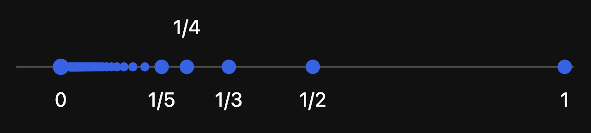
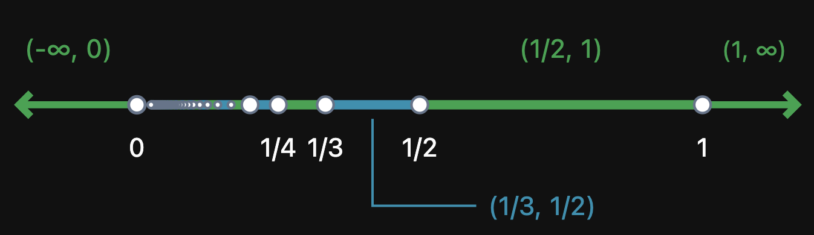

## 무한히 많은 조건을 유한개로 줄일 수 있는 때는 언제인가

유한개의 양수 $\delta_1, \delta_2, ..., \delta_n$ 중 가장 작은 값은 여전히 양수입니다. 무한개라면 그 하한이 0일 수 있습니다. 해석학의 많은 시도는 "점마다 따로 성립하는 조건"을 "한꺼번에 성립하는 조건"으로 바꾸려 하고, 그 연결고리가 되는 것이 컴팩트성(Compactness) 입니다.

이 글에서는 $\mathbb{R}$만 다룹니다.

정의 1 (열린집합; Open Set)

$G \subset \mathbb{R}$의 모든 점 $x$에 대해 $(x - \epsilon, x+ \epsilon) \subset G$인 $\epsilon >0$이 있으면 $G$를 열린집합이라 한다.

직관적으로는 "어느 점에서든 양쪽으로 조금은 움직일 여유가 있다"는 뜻입니다.

- **예**: $(0,1)$. $x \in (0,1)$이면 $\epsilon = \min(x, 1-x)$로 잡습니다. $x=0.3$이면 $\epsilon = \min(0.3,0.7) = 0.3$이고, $(0, 0.6) \subset (0,1)$입니다. $x=0.0001$이면 $\epsilon = 0.0001$로 작아지지만 0은 아니고, $(0, 0.0002) \subset (0,1)$이므로 정의를 충족합니다. 끝점 0과 1이 집합에 없기 때문에, 집합 안의 어떤 점도 경계에 딱 붙어 있지 않습니다.
- **예가 아님**: $[0,1)$. 점 0에서 $\epsilon$을 아무리 작게 잡아도 $(-\epsilon, \epsilon)$에는 $-\epsilon/2$ 같은 음수가 들어 있고, 음수는 $[0,1)$에는 없습니다. 한 점에서만 실패해도 열린집합이 아닙니다. 같은 이유로 $E = (0,1]$은 점 1에서 실패합니다.

정의 2 (닫힌집합; Closed Set)

여집합 $\mathbb{R} \setminus F$가 열린집합이면 $F$를 닫힌집합이라 한다.

이것은 "$F$ 안의 수열이 수렴하면 그 극한도 $F$에 속한다"는 조건과 동치입니다. 직관적으로는 "집합 안에서 움직이는 수열이 극한에서 밖으로 빠져나가지 못한다"는 뜻입니다.

- **예**: $[0,1]$. 여집합 $(-\infty,0) \cup (1, \infty)$은 두 열린구간의 합이라 열려 있습니다. 수열로 보면 $[0,1]$ 안의 수열은 $0 \le x_n \le 1$이므로 극한도 $0$ 이상 $1$ 이하입니다.
- **예가 아님**: $E = (0, 1]$. $1/n$은 $E$ 안의 수열인데 극한 0은 $E$에 없습니다. 여집합 $(-\infty, 0] \cup (1, \infty)$으로 보면, 점 0에서 $(-\epsilon, \epsilon)$가 $E$의 점을 포함하므로 여집합이 열려 있지 않습니다.
- **예**: $K = \{0\} \cup \{1/n : n \in \mathbb{N}\}$. 무한집합이지만 수열 $1/n$의 극한 0을 포함하므로 닫혀 있습니다. 0을 뺀 $\{1/n : n \in \mathbb{N}\}$은 닫혀 있지 않습니다.

열림과 닫힘은 반대말이 아닙니다. $E$와 $[0,1)$은 둘 다 아니고, $\mathbb{R}$과 $\emptyset$은 둘 다입니다(clopen). 공집합이 열려 있는 이유는 확인할 점이 하나도 없어서 조건이 공허하게 참이기 때문이고, $\mathbb{R}$은 그 여집합이므로 닫혀 있습니다.

정의 3 (열린덮개; Open Cover)

열린집합들의 모임(집합족) $\mathcal{G}$이 $K \subset \bigcup_{G \in \mathcal{G}} G$를 만족하면 $\mathcal{G}$를 $K$의 열린덮개라 한다. $\mathcal{G}$에서 유한개를 골라 여전히 $K$를 덮으면 유한부분덮개(Finite Subcover)라 한다.

- **예1**: $[0,1]$을 덮는 짧은 구간들. $\mathcal{G} = \{(x-0.1, x+0.1): x \in [0,1]\}$은 원소가 비가산개인 열린덮개입니다. 이때 중심이 $0, 0.1, 0.2, \ldots, 1$인 11개만 골라도 이웃한 구간끼리 겹치므로 $[0,1]$이 덮입니다. 이것이 유한부분덮개입니다.
- **예2**: $\mathbb{R}$을 덮는 구간들. $\{(n-1, n+1): n \in \mathbb{Z}\}$는 $\mathbb{R}$의 열린덮개입니다. 그러나 유한개를 고르면 합집합이 유계이므로 $\mathbb{R}$을 덮지 못합니다. 유한부분덮개가 없는 열린덮개입니다.
- **예3**: $[0,1]$과 $\{(1/n, 2): n \in \mathbb{N}\}$. 합집합이 $(0,2)$라서 0이 덮이지 않습니다. 열린덮개가 되지 못합니다.

정의 4 (컴팩트; Compact)

$K$의 **모든** 열린덮개가 유한부분덮개를 가지면 $K$를 컴팩트(Compact)라 한다.

"모든"이 핵심입니다. $E = (0,1]$도 $\{(-1,2)\}$ 하나로 덮을 수 있고, 이 덮개는 이미 유한합니다. 하지만 유한부분덮개가 없는 덮개를 하나라도 만들 수 있으면 컴팩트가 아닙니다.

$$
K \text{ is compact} \iff \forall\, \mathcal{G} \text{ Open Cover},\ \exists\, G_1,\dots,G_m \in \mathcal{G}:\ K \subset G_1 \cup \cdots \cup G_m
$$

$E=(0,1]$. $G_n=(1/n,2)$로 두면 각 $G_n$은 열린집합이고, 합집합은 $(0,2)$라서 $E$를 덮습니다. 그런데 유한개를 고르고 $N = \max n_i$라 하면 합집합은 $G_N = (1/N,2)$입니다. 점 $1/(2N)$은 $E$에 속하지만 $G_N$에 속하지 않아 덮이지 않습니다. 따라서 $E$는 컴팩트하지 않습니다.

무엇이 문제였는지는 명확합니다. 덮개의 구간들이 0쪽으로 다가가는데, 0이 $E$에 없어서 "0을 감싸는 하나의 열린집합"으로 그 꼬리를 한번에 처리할 수 없습니다. $[0,1]$이라면 0을 포함하는 어떤 $G_j$가 $[0, \epsilon]$을 통째로 덮어줄 수 있었습니다.

## $\mathbb{R}$의 열린집합은 가산개의 서로소 열린구간의 합이다

$\mathbb{R}$의 열린집합은 아무리 복잡해 보여도 서로소 열린구간들을 가산개 모은 것입니다. 그래서 열린집합의 "길이"를 구간 길이의 합으로 정의할 수 있습니다.

먼저 증명에 필요한 도구 하나를 준비합니다. 어느 구간에나 유리수가 있다는 사실이고, 상한공리에서 시작합니다.

보조정리 1 (조밀성; Density)

$a < b$이면 $a < q < b$인 유리수 $q$와 $a < s < b$인 무리수 $s$가 있다.

**증명.**

(1) **아르키메데스 성질**: 모든 실수 $x$에 대해 $n > x$인 $n \in \mathbb{N}$이 있다. 그러지 않다면 $\mathbb{N}$은 $x$로 위로 유계이고, 상한공리에 의해 $c = \sup \mathbb{N}$이 존재합니다. $c - 1$은 상계가 아니므로 $n > c - 1$인 $n \in \mathbb{N}$이 있습니다. 그러면 $n + 1 \in \mathbb{N}$이고 $n + 1 > c$이므로 $c$가 상계라는 것에 모순입니다.

(2) **유리수**: (1)로 $n > 1/(b - a)$인 $n$을 잡으면 $nb - na > 1$입니다. $na$보다 큰 정수는 (1)에 의해 존재하고, 그런 정수들은 $na$로 아래로 유계이므로 가장 작은 것 $m$이 있습니다. $m$이 가장 작으므로 $m - 1 \le na$이고, 따라서 $na < m \le na + 1 < nb$입니다. $n$으로 나누면 $a < m/n < b$입니다.

(3) **무리수**: (2)를 구간 $(a - \sqrt{2},\, b - \sqrt{2})$에 쓰면 그 안에 유리수 $q$가 있습니다. $s = q + \sqrt{2}$라 하면 $a < s < b$입니다. $s$가 유리수라면 $\sqrt{2} = s - q$도 유리수가 되는데, $\sqrt{2}$는 유리수가 아닙니다. $\blacksquare$

정리 1

$G \subset \mathbb{R}$가 열린집합이면, 서로소인 열린구간들의 가산 모임 $\{I_k\}$가 있어서 $G = \bigcup_k I_k$이다. 여기서 열린구간은 $(a, b)$, $(a, \infty)$, $(-\infty, b)$, $(-\infty, \infty)$를 모두 포함한다.

**증명.**

(1) **점마다 가장 큰 구간을 잡는다**: $x \in G$에 대해 $a_x = \inf\{a < x : (a, x) \subset G\}$, $b_x = \sup\{b > x : (x, b) \subset G\}$라 둡니다. $G$가 열려 있으므로 두 집합은 공집합이 아니고, 아래나 위로 유계가 아니면 값은 $-\infty$, $+\infty$입니다. $I_x = (a_x, b_x)$라 하면 $I_x \subset G$입니다. $a_x < y < x$인 $y$를 잡으면 $\inf$의 정의에 의해 $a < y$이고 $(a, x) \subset G$인 $a$가 있기 때문입니다. 오른쪽도 같습니다.

(2) **$I_x$는 $x$를 포함하는 가장 큰 열린구간이다**: $J = (c, d) \subset G$이고 $x \in J$이면 $(c, x) \subset G$이므로 $a_x \le c$, 같은 이유로 $d \le b_x$입니다. 따라서 $J \subset I_x$입니다.

(3) **서로 다른 $I_x$들은 서로소이다**: $I_x$와 $I_y$가 한 점이라도 공유한다고 합시다. 겹치는 두 열린구간의 합집합 $I_x \cup I_y$는 다시 열린구간이고 $G$ 안에 있습니다. 이 구간은 $x$를 포함하므로 $I_x$에, $y$를 포함하므로 $I_y$에 들어갑니다. 그러면 $I_x = I_y$입니다. 즉 서로 다른 $I_x$들은 서로소이고, $G = \bigcup_{x \in G} I_x$입니다.

(4) **구간마다 유리수를 하나씩 대응시킨다**: 1편에서 본 대로 $\mathbb{Q}$는 가산이므로 나열 $q_1, q_2, q_3, \ldots$을 하나 고정합니다. 보조정리 1에 의해 각 $I_x$는 유리수를 포함합니다. 구간 $I$에 "$q_n \in I$인 가장 작은 $n$"을 대응시키면, 구간들이 서로소이므로 이 대응은 단사입니다. $\mathbb{N}$으로 가는 단사가 있으므로 구간은 가산개입니다. $\blacksquare$

**$E = (0,1]$ 근처에서 보기.** $E$는 1에서 오른쪽 구간을 품지 못해서 열린집합이 아닙니다. 대신 $K = \{0\} \cup \{1/n : n \in \mathbb{N}\}$을 봅시다.

$K$에서 수렴하는 수열의 극한은 0이거나 $K$의 점이므로 $K$는 닫혀 있고, $G = \mathbb{R} \setminus K$는 열린집합입니다. 정리 1의 분해는 다음과 같습니다.

$$
\mathbb{R}\setminus K = (-\infty, 0)\ \cup\ \bigcup_{n=1}^{\infty}\left(\tfrac{1}{n+1}, \tfrac{1}{n}\right)\ \cup\ (1, \infty)
$$

구간이 가산 무한개입니다. 유한개가 아니라 "가산개"가 정리의 정확한 답이라는 것을 보여 줍니다.

## Heine-Borel Theorem

$\mathbb{R}$의 부분집합은 닫혀 있고 유계일 때, 그리고 그때에만 컴팩트입니다.

정리 2

$a < b$이면 $[a, b]$는 컴팩트이다.

**증명.** $\mathcal{G}$를 $[a, b]$의 열린덮개라 하고 다음 집합을 둡니다.

$$
S = \{\, x \in [a,b] : [a,x] \text{가 } \mathcal{G}\text{의 유한개 원소로 덮인다} \,\}
$$

(1) **$S$의 상한 $c$가 존재한다**: $a$는 $\mathcal{G}$의 어떤 원소에 속하므로 $[a, a] = \{a\}$는 하나로 덮이고, $a \in S$입니다. $S$는 $b$로 위로 유계입니다. 상한공리에 의해 $c = \sup S$가 존재하고, $a \le c \le b$입니다.

(2) **$c$ 근처를 하나의 열린집합으로 처리한다**: $c \in [a, b]$이므로 $c$를 포함하는 $G_0 \in \mathcal{G}$가 있고, $(c - \epsilon, c + \epsilon) \subset G_0$인 $\epsilon > 0$이 있습니다. $c$가 $S$의 가장 작은 상계이므로 $c - \epsilon < x \le c$인 $x \in S$가 있습니다. $[a, x]$를 덮는 유한개 $G_1, \ldots, G_m$에 $G_0$을 더하면 $[a, y]$가 덮입니다. 여기서 $y = \min(c + \epsilon/2,\, b)$입니다. 즉 $y \in S$입니다.

(3) **$c = b$이고 $b \in S$이다**: $c < b$이면 $y > c$인데 $y \in S$이므로 $c$가 상계라는 사실에 모순입니다. 따라서 $c = b$이고, 이때 $y = b$이므로 $b \in S$, 곧 $[a, b]$ 전체가 유한개로 덮입니다. $\blacksquare$

이 증명은 "얼마나 멀리까지 유한개로 덮을 수 있는가"를 $\sup$으로 잡고, 그 끝점 $c$가 집합 안에 있어서 한 개의 $G_0$으로 더 밀고 나갈 수 있다는 구조입니다.

정리 3 (Heine–Borel)

$K \subset \mathbb{R}$에 대해 다음은 동치이다.

- $K$는 컴팩트이다.
- $K$는 닫혀 있고 유계이다.

**증명.** 세 방향을 차례로 보입니다.

(1) **컴팩트 $\Rightarrow$ 유계**: $(-n, n)$들은 $K$를 덮습니다. 유한부분덮개의 번호 중 최댓값을 $N$이라 하면 $K \subset (-N, N)$입니다.

(2) **컴팩트 $\Rightarrow$ 닫힘**: $p \notin K$를 잡고 $G_n = \{x : \lvert x - p \rvert > 1/n\}$라 둡니다. 각 $G_n$은 열려 있고, $p \notin K$이므로 $G_n$들은 $K$를 덮습니다. $G_n$은 $n$이 커질수록 커지므로 유한부분덮개는 하나의 $G_N$으로 바꿀 수 있고, $K \subset G_N$입니다. 그러면 $(p - 1/N,\, p + 1/N)$은 $K$와 만나지 않습니다. $\mathbb{R} \setminus K$의 모든 점에서 이렇게 되므로 $\mathbb{R} \setminus K$는 열려 있고, $K$는 닫혀 있습니다.

(3) **닫힘 + 유계 $\Rightarrow$ 컴팩트**: $K \subset [a, b]$인 $a, b$를 잡고 $\mathcal{G}$를 $K$의 열린덮개라 합시다. $K$가 닫혀 있으므로 $\mathbb{R} \setminus K$는 열린집합이고, $\mathcal{G}$에 $\mathbb{R} \setminus K$를 추가하면 $[a, b]$의 열린덮개가 됩니다. 정리 2로 유한부분덮개를 고르고 거기서 $\mathbb{R} \setminus K$를 빼면, 남은 유한개가 $K$를 덮습니다. $\blacksquare$

## 수열의 Compactness: Bolzano-Weierstrass

덮개로 정의한 컴팩트성은 수열의 말로 바꾸면 "모든 수열이 수렴하는 부분수열을 가진다"가 됩니다. 이것으로 "$\mathbb{R}$에서는 모든 코시 수열이 수렴한다"를 증명합니다.

정리 4 (Bolzano–Weierstrass)

$K \subset \mathbb{R}$가 컴팩트이면 $K$ 안의 모든 수열은 $K$의 점으로 수렴하는 부분수열을 가진다. 특히 $\mathbb{R}$의 모든 유계 수열은 수렴하는 부분수열을 가진다.

**증명.** $(x_n)$을 $K$ 안의 수열이라 합시다. 점 $p$의 모든 근방 $(p - \epsilon, p + \epsilon)$에 $x_n$이 무한히 많은 번호 $n$에 대해 들어 있으면, $p$를 "집중점"이라 부르겠습니다.

(1) **$K$ 안에 집중점이 있다**: 없다고 합시다. 그러면 각 $p \in K$마다 열린구간 $U_p \ni p$가 있어서, $x_n \in U_p$인 번호 $n$은 유한개뿐입니다. $\{U_p\}$는 $K$의 열린덮개이므로 유한개 $U_{p_1}, \ldots, U_{p_m}$가 $K$를 덮습니다. 모든 $x_n$은 이 $m$개 중 어딘가에 있어야 하는데, 각각에 들어가는 번호는 유한개입니다. 유한개의 유한집합을 합쳐도 유한집합이므로 $\mathbb{N}$ 전체가 될 수 없습니다. 모순입니다.

(2) **집중점으로 가는 부분수열을 뽑는다**: $p \in K$를 집중점이라 합시다. $\lvert x_{n_1} - p \rvert < 1$인 $n_1$을 고릅니다. $n_1, \ldots, n_{k-1}$을 고르고 나면, $(p - 1/k,\, p + 1/k)$에 들어가는 번호가 무한히 많으므로 그 중 $n_{k-1}$보다 큰 것을 $n_k$로 고릅니다. 이때도 "조건을 만족하는 가장 작은 번호"를 고르면 선택공리가 필요 없습니다. 그러면 $\lvert x_{n_k} - p \rvert < 1/k$이므로 $x_{n_k} \to p$입니다.

(3) **유계 수열의 경우**: 유계 수열은 어떤 $[a, b]$ 안에 있고, $[a, b]$는 정리 2에 의해 컴팩트입니다. $\blacksquare$

정리 5 (코시 $\Rightarrow$ 수렴)

$\mathbb{R}$의 모든 코시 수열은 수렴한다.

**증명.** $(x_n)$을 코시 수열이라 합시다.

(1) **유계이다**: $\epsilon = 1$에 대해 $n, m \ge N$이면 $\lvert x_n - x_m \rvert < 1$인 $N$이 있습니다. 그러면 모든 $n$에 대해 $\lvert x_n \rvert \le \max(\lvert x_1 \rvert, \ldots, \lvert x_N \rvert, \lvert x_N \rvert + 1)$입니다.

(2) **수렴하는 부분수열이 있다**: 정리 4에 의해 $x_{n_k} \to L$인 부분수열과 $L$이 있습니다.

(3) **전체가 $L$로 간다**: $\epsilon > 0$이 주어지면 $n, m \ge N$일 때 $\lvert x_n - x_m \rvert < \epsilon/2$인 $N$을 잡습니다. $n_k \ge N$이고 $\lvert x_{n_k} - L \rvert < \epsilon/2$인 $k$를 하나 고릅니다. 그러면 $n \ge N$인 모든 $n$에 대해 다음이 성립합니다.

$$
\lvert x_n - L \rvert \le \lvert x_n - x_{n_k} \rvert + \lvert x_{n_k} - L \rvert < \frac{\epsilon}{2} + \frac{\epsilon}{2} = \epsilon. \qquad \blacksquare
$$

역방향 "수렴 $\Rightarrow$ 코시"는 어느 공간에서나 성립합니다. 의존 사슬을 따라가면 상한공리 $\to$ 정리 2 $\to$ 정리 4 $\to$ 정리 5입니다. $\mathbb{Q}$에서는 2단계가 깨집니다. 2편 1절의 $\sqrt{2}$ 근사수열은 코시이지만, $\mathbb{Q}$ 안에는 수렴하는 부분수열의 극한이 없습니다.

## 마치며

콤팩트성은 무한집합을 유한집합으로 만드는 성질이 아닙니다. 무한히 많은 원소를 가진 집합을 유한한 정보로 통제할 수 있게 하는 성질입니다.

열린덮개에서는 유한부분덮개를 추출하고, 수열에서는 수렴하는 부분수열을 추출합니다. 이후 연속함수를 공부할 때는 점마다 성립하는 연속성을 집합 전체에서 성립하는 균등연속성으로 강화하는 데에도 콤팩트성이 사용되게 됩니다.

결국 콤팩트성은 국소적인 성질을 전역적인 성질로 확장하는 해석학의 핵심 도구입니다.

