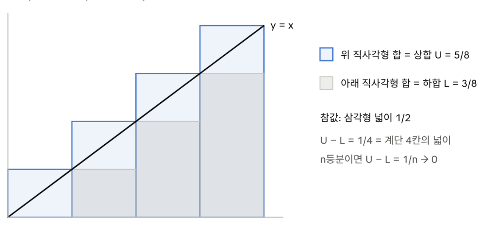
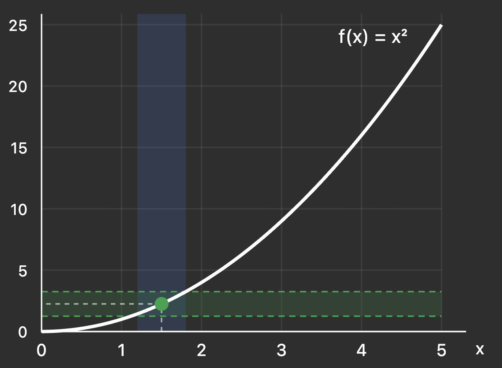
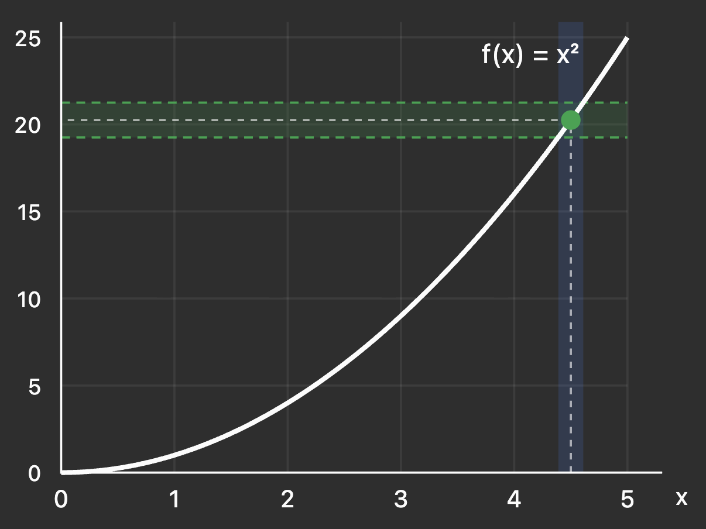

함수 $f \ge 0$일 때 그래프 아래 영역 $\{(x, y) : a \le x \le b,\ 0 \le y \le f(x)\}$는 집합으로 나타낼 수 있지만, 그것만으로 넓이가 정의되는 것은 아닙니다. 리만적분은 이 영역을 넓이를 알고 있는 직사각형들의 합으로 위아래에서 조여서, 두 근사가 같은 값으로 모이면 그 값을 넓이로 정의합니다. 근사에 쓰는 것은 각 조각에서 함숫값의 sup과 inf뿐이므로, 함수가 식으로 주어질 필요는 없습니다. $f$가 음수 값을 가지면 같은 정의가 $x$축 아래 부분을 음수로 세는 "부호 있는 넓이"를 줍니다.

이 글의 모든 논의는 유계구간 $[a, b]$ 위의 유계함수 $f$를 전제합니다. 조각마다 sup과 inf이 실수로 존재해야 하기 때문이고, 그 존재를 보장하는 것은 상한공리입니다.

**기호.** $[a, b]$의 분할 $P$는 $a = x_0 < x_1 < \cdots < x_n = b$인 유한개의 점입니다. $\Delta x_i = x_i - x_{i-1}$이고, 분할의 눈금은 $\max_i \Delta x_i$입니다. $P \subseteq P^{\ast}$이면 $P^{\ast}$를 $P$의 세분이라 합니다. 분할 $P$는 구간을 나누는 '점들의 집합'입니다. 따라서 $P^{\ast}$가 $P$의 점들을 모두 포함하면서 새로운 분할점들을 더 가지고 있으므로, 실제 구간은 더 작고 촘촘하게 나뉘게 됩니다.

## 다르부 상합과 하합

$f$가 적분 가능하다는 것은 위에서의 근사와 아래에서의 근사가 같은 값으로 모인다는 뜻입니다. 실제로 확인할 때는 "$U - L$을 얼마든지 작게 만드는 분할이 있는가"만 보면 됩니다.

정의 1 (다르부 상합과 하합; Darboux Sums)

분할 $P$의 $i$번째 조각에서 $M_i = \sup_{[x_{i-1}, x_i]} f$, $m_i = \inf_{[x_{i-1}, x_i]} f$라 둡니다.

$$U(f,P) = \sum_{i=1}^{n} M_i\,\Delta x_i, \qquad L(f,P) = \sum_{i=1}^{n} m_i\,\Delta x_i$$

**예.** $[0, 1]$에서 $f(x) = x$. $n$등분 $P_n = \{0, 1/n, 2/n, \dots, 1\}$을 잡습니다. 조각 $[(i-1)/n,\ i/n]$에서 $f$는 증가하므로 $M_i = i/n$, $m_i = (i-1)/n$이고, $\Delta x_i = 1/n$입니다. $1 + 2 + \cdots + n = n(n+1)/2$를 쓰면 다음과 같습니다.

$$U(f,P_n) = \sum_{i=1}^{n} \frac{i}{n}\cdot\frac{1}{n} = \frac{n+1}{2n}, \qquad L(f,P_n) = \sum_{i=1}^{n} \frac{i-1}{n}\cdot\frac{1}{n} = \frac{n-1}{2n}$$

$n = 4$이면 $U = 5/8 = 0.625$, $L = 3/8 = 0.375$입니다. 두 값의 차이는 $1/n$이고, $n$이 커지면 둘 다 $1/2$로 모입니다. 삼각형의 넓이 $1/2$가 위아래에서 조여지는 것입니다.

회색 직사각형(하합)은 그래프 아래에 머물고, 파란 테두리 직사각형(상합)은 그래프 위까지 올라갑니다. 둘의 차이인 계단 4칸이 $U - L$이고, 분할을 잘게 할수록 이 계단이 얇아집니다.

보조정리 1 (세분하면 근사가 좋아진다)

$P^{\ast}$가 $P$의 세분이면 $L(f, P) \le L(f, P^{\ast}) \le U(f, P^{\ast}) \le U(f, P)$입니다.

**증명.** 점을 하나씩 추가하는 경우만 보면 됩니다. $[x_{i-1}, x_i]$에 점 $y$를 넣으면 조각 하나가 $[x_{i-1}, y]$와 $[y, x_i]$로 나뉩니다. 작은 집합의 sup은 큰 집합의 sup보다 크지 않으므로 두 조각의 상한은 모두 $M_i$ 이하이고, 상합은 줄거나 그대로입니다. 하합도 같은 이유로 늘거나 그대로입니다. 가운데 부등호는 $m_i \le M_i$에서 나옵니다. $\blacksquare$

**예.** 위의 $f(x) = x$에서 $P = \{0, 1/2, 1\}$이면 $U(f, P) = (1/2)(1/2) + 1\cdot(1/2) = 3/4$, $L(f, P) = 0\cdot(1/2) + (1/2)(1/2) = 1/4$입니다. 점 $1/4$을 추가한 $P^{\ast} = \{0, 1/4, 1/2, 1\}$에서는 첫 조각 $[0, 1/2]$만 둘로 나뉩니다. 나눈 조각 $[0, 1/4]$에서는 상한이 $1/2$에서 $1/4$로 낮아지고, $[1/4, 1/2]$에서는 하한이 $0$에서 $1/4$로 높아집니다. 나머지 조각 $[1/2, 1]$은 그대로이므로, 바뀐 것은 나눠둔 부분뿐입니다.

두 분할 $P, Q$가 있으면 $P \cup Q$는 둘의 공통 세분입니다. 보조정리 1을 두 번 쓰면 $L(f, P) \le L(f, P \cup Q) \le U(f, P \cup Q) \le U(f, Q)$입니다. 즉 어떤 하합도 어떤 상합보다 크지 않습니다. 그래서 아래의 두 값, 하적분과 상적분이 존재하고 하적분 $\le$ 상적분입니다. 하합들은 위로 유계이므로 sup이, 상합들은 아래로 유계이므로 inf이 있습니다.

$$\underline{\int_a^b} f = \sup_P L(f,P) \;\le\; \overline{\int_a^b} f = \inf_P U(f,P)$$

두 값이 같으면 $f$를 리만적분 가능하다고 하고, 그 값을 $\int_a^b f$로 씁니다.

정리 1 (리만 판정법)

$f$가 적분 가능한 것은 모든 $\varepsilon > 0$에 대해 $U(f, P) - L(f, P) < \varepsilon$인 분할 $P$가 존재하는 것과 동치입니다.

**증명.**

- ($\Leftarrow$) 어떤 $P$에 대해서도 $L(f, P) \le$ 하적분 $\le$ 상적분 $\le U(f, P)$이므로 $0 \le$ 상적분 $-$ 하적분 $< \varepsilon$입니다. $\varepsilon$은 임의이므로 두 값이 같습니다.
- ($\Rightarrow$) $I = \int_a^b f$라 합시다. inf과 sup의 정의에 의해 $U(f, P_1) < I + \varepsilon/2$, $L(f, P_2) > I - \varepsilon/2$인 분할이 있습니다. $P = P_1 \cup P_2$라 하면 보조정리 1에 의해 $U(f, P) - L(f, P) \le U(f, P_1) - L(f, P_2) < \varepsilon$입니다. $\blacksquare$

**예.** $f(x) = x$에서는 $U(f, P_n) - L(f, P_n) = 1/n$입니다. $\varepsilon$이 주어지면 $n > 1/\varepsilon$인 $n$을 고르면 되므로 $f$는 적분 가능합니다. 값도 바로 정해집니다. 모든 $n$에 대해 $\frac{n-1}{2n} \le \int_0^1 x\,dx \le \frac{n+1}{2n}$이므로 $\int_0^1 x\,dx = 1/2$입니다. 정리 1은 "상적분과 하적분을 따로 구하지 말고, 좋은 분할 하나만 찾으면 된다"는 뜻입니다.

다르부 방식의 리만적분에서 유계성은 상한공리를 적용할 수 있게 하고, 상한공리는 상적분과 하적분의 존재를 보장합니다. 따라서 적분가능성은 적분값이 존재하는지를 직접 묻는 대신, 이미 존재하는 두 근사의 극한값(상적분과 하적분)이 일치하는지를 묻는 문제로 바꾸어 생각해볼 수 있습니다.

## 디리클레 함수와 단조함수

디리클레 함수는 어떤 분할에서도 $U-L=1$이므로 적분 불가능합니다. 반면 단조함수는 불연속점이 무한히 많더라도 적분 가능합니다. 두 예는 불연속점의 개수만으로는 적분가능성을 판단할 수 없음을 보여 줍니다. 불연속점 집합의 크기를 어떻게 측정할 것인가는 이후 측도론에서 다룰 문제이며, 여기에서는 유계인 함수이더라도 적분 불가능할 수 있음을 보이고자 합니다. 즉, 유계성은 리만적분가능성의 필요조건이지, 충분조건은 아닙니다.

**디리클레 함수.** $[0, 1]$에서 $x \in \mathbb{Q}$이면 $f(x) = 1$, 아니면 $f(x) = 0$으로 둡니다. 3편 2절의 조밀성(보조정리 1)에 의해 길이가 양수인 모든 구간에는 유리수와 무리수가 모두 있습니다. 따라서 어떤 분할에서도 모든 조각에서 $M_i = 1$, $m_i = 0$이고, $U(f, P) = 1$, $L(f, P) = 0$입니다. 상적분은 1, 하적분은 0이므로 적분 불가능합니다.

**단조함수.** $f$가 $[a, b]$에서 증가함수라 합시다. 단조이므로 $f(a) \le f(x) \le f(b)$라서 자동으로 유계입니다. $n$등분할 $P_n$을 잡으면 $\Delta x_i = (b - a)/n$이고, 증가함수이므로 각 조각에서 $M_i = f(x_i)$, $m_i = f(x_{i-1})$입니다. 합이 망원식으로 사라집니다.

$$U(f,P_n) - L(f,P_n) = \sum_{i=1}^{n} \big(f(x_i) - f(x_{i-1})\big)\frac{b-a}{n} = \big(f(b) - f(a)\big)\frac{b-a}{n} \xrightarrow{\,n\to\infty\,} 0$$

정리 1에 의해 $f$는 적분 가능합니다. $\blacksquare$

$E = (0,1]$에서 보기. $[0, 1]$에서 다음 계단함수를 봅시다.

$$f(0) = 0, \qquad f(x) = \tfrac{1}{n} \quad \text{for } x \in \left(\tfrac{1}{n+1}, \tfrac{1}{n}\right],\ n = 1, 2, \dots$$

$E$의 각 점은 정확히 하나의 조각 $(1/(n+1), 1/n]$에 속하므로 잘 정의됩니다. $f$는 증가함수이고, 불연속점은 $x = 1/2, 1/3, 1/4, \dots$로 가산 무한개입니다. 0에서는 $x \le f(x) < 2x$이므로 연속입니다. 그래도 위 증명에 의해 적분 가능합니다.

## 연속함수는 적분 가능하다

$[a, b]$ 위의 연속함수는 적분 가능합니다. 핵심은 콤팩트 집합 위에서 연속성이 고른연속성으로 올라간다는 것입니다.

연속과 미분을 정의하려면 먼저 함수의 극한이 필요합니다. 수열의 극한에서 "$n \ge N$"을 "$0 < \lvert x - p \rvert < \delta$"로 바꾸어 생각한 것입니다.

정의 2 (함수의 극한)

$f: D \to \mathbb{R}$이고, $p$는 $D$의 점들이 얼마든지 가까이 다가갈 수 있는 점이라 합시다. 즉 모든 $\delta > 0$에 대해 $0 < \lvert x - p \rvert < \delta$인 $x \in D$가 있습니다. 모든 $\varepsilon > 0$에 대해 다음을 만족하는 $\delta > 0$이 있으면 $\lim_{x\to p} f(x) = L$이라 씁니다.

$$x \in D,\ 0 < |x - p| < \delta \;\Longrightarrow\; |f(x) - L| < \varepsilon$$

$0 <$가 핵심입니다. 극한은 $p$ 근처의 값만 보고 $p$에서의 값은 보지 않으므로, $p$가 $D$에 없어도 극한을 말할 수 있습니다. 예를 들어 $E = (0,1]$에서 $f(x) = x$이면 $0 \notin E$이지만 $\lim_{x\to 0} f(x) = 0$입니다. 수열의 말로 바꾸면, $\lim_{x\to p} f(x) = L$인 것은 $p$로 수렴하는 $D \setminus \{p\}$의 모든 수열 $(x_n)$에 대해 $f(x_n) \to L$인 것과 동치입니다.

**한쪽 극한.** 위 정의에서 $x$를 $p$보다 큰 점으로만 제한한 극한을 오른쪽 극한 $f(p+)$, $p$보다 작은 점으로만 제한한 극한을 왼쪽 극한 $f(p-)$라 합니다. 극한이 존재하는 것은 두 한쪽 극한이 모두 존재하고 값이 같은 것과 동치입니다.

- **값이 어긋나는 예.** 3절의 계단함수에서 $x = 1/2$ 바로 왼쪽은 조각 $(1/3, 1/2]$에 있어서 값이 $1/2$이고, 바로 오른쪽은 $(1/2, 1]$에 있어서 값이 1입니다. $f(1/2-) = 1/2$, $f(1/2+) = 1$이므로 극한이 없습니다. 두 값의 차이가 이 점에서의 점프이고, 5편은 이 점프들로 단조함수의 불연속점을 셉니다.
- **한쪽 극한도 없는 예.** $E$에서 $1/x$는 $x \to 0+$일 때 유계가 아니므로 $f(0+)$가 없습니다.

이 극한으로 아래의 연속을 다시 읽으면, $D$의 점 $p$가 위와 같은 점일 때 $f$가 $p$에서 연속인 것은 $\lim_{x\to p} f(x) = f(p)$인 것과 같습니다. "극한이 있고, 그 값이 함숫값과 일치한다"는 뜻입니다.

정의 3 (연속과 고른연속)

$f$가 집합 $D$ 위에서 정의되어 있다고 합시다.

- **연속**: 모든 $x \in D$와 $\varepsilon > 0$에 대해, $\lvert y - x \rvert < \delta$인 모든 $y \in D$에서 $\lvert f(y) - f(x) \rvert < \varepsilon$인 $\delta > 0$이 있습니다. $\delta$는 $\varepsilon$과 $x$에 따라 달라질 수 있습니다.
- **고른연속**: 모든 $\varepsilon > 0$에 대해, $\lvert x - y \rvert < \delta$인 모든 $x, y \in D$에서 $\lvert f(x) - f(y) \rvert < \varepsilon$인 $\delta > 0$이 있습니다. $\delta$는 $\varepsilon$에만 달려 있습니다. **즉, 정의역 어디에서든 같은 $\delta$를 사용할 수 있어야 합니다.**

**예.** $[0, 1]$에서 $f(x) = x^2$. $x, y \in [0, 1]$이면 $x + y \le 2$이므로 다음이 성립합니다.

$$\lvert x^2 - y^2 \rvert = \lvert x + y \rvert\,\lvert x - y \rvert \le 2\,\lvert x - y \rvert$$

따라서 $\delta = \varepsilon/2$로 잡으면 $[0, 1]$의 어느 두 점에서나 $\lvert x - y \rvert < \delta \Rightarrow \lvert x^2 - y^2 \rvert < \varepsilon$입니다. $\delta$가 $\varepsilon$에만 달려 있으므로 고른연속입니다.

같은 함수도 $\mathbb{R}$ 전체에서는 고른연속이 아닙니다. $x = n$, $y = n + 1/n$이면 $\lvert y - x \rvert = 1/n \to 0$인데 $y^2 - x^2 = 2 + 1/n^2 > 2$입니다. $\varepsilon = 2$에 대해 어떤 $\delta$도 통하지 않습니다. 그래프의 기울기가 끝없이 가파르기 때문이고, $[0, 1]$처럼 유계인 구간으로 제한하면 기울기가 2 이하로 묶입니다.

같은 $\varepsilon$을 유지하려면 $\delta$가 점점 작아져야 합니다.

정리 2 (콤팩트 위 연속 $\Rightarrow$ 고른연속)

$K \subset \mathbb{R}$가 콤팩트이고 $f$가 $K$ 위에서 연속이면, $f$는 $K$ 위에서 고른연속입니다.

**증명.** $\varepsilon > 0$을 고정합니다.

- **점마다 $\delta$를 잡는다.** 각 $p \in K$에 대해, $y \in K$이고 $\lvert y - p \rvert < \delta_p$이면 $\lvert f(y) - f(p) \rvert < \varepsilon/2$인 $\delta_p > 0$이 있습니다.
- **덮개로 유한개로 줄인다.** $U_p = (p - \delta_p/2,\ p + \delta_p/2)$들은 $K$의 열린덮개입니다. $K$가 콤팩트이므로 유한개 $U_{p_1}, \dots, U_{p_m}$이 $K$를 덮습니다. $\delta = \min(\delta_{p_1}, \dots, \delta_{p_m})/2$로 둡니다. 유한개의 양수 중 최솟값이므로 $\delta > 0$입니다.
- **$\delta$가 모든 점에서 통한다.** $x, y \in K$이고 $\lvert x - y \rvert < \delta$라 합시다. $x$는 어떤 $U_{p_i}$에 있으므로 $\lvert x - p_i \rvert < \delta_{p_i}/2$입니다. 또 $\lvert y - p_i \rvert \le \lvert y - x \rvert + \lvert x - p_i \rvert < \delta + \delta_{p_i}/2 \le \delta_{p_i}$입니다. $x$와 $y$가 모두 $p_i$의 $\delta_{p_i}$-근방에 있으므로 다음이 성립합니다.

$$\lvert f(x) - f(y) \rvert \le \lvert f(x) - f(p_i) \rvert + \lvert f(p_i) - f(y) \rvert < \tfrac{\varepsilon}{2} + \tfrac{\varepsilon}{2} = \varepsilon \qquad \blacksquare$$

정리 3 (최대·최소 정리)

$K \subset \mathbb{R}$가 공집합이 아닌 콤팩트 집합이고 $f$가 $K$ 위에서 연속이면, $f$는 $K$에서 최댓값과 최솟값을 가집니다. 즉 $f(p) = \sup f(K)$, $f(q) = \inf f(K)$인 $p, q \in K$가 있습니다.

**증명.** 공집합이 아닌 콤팩트 집합 $K \subseteq \mathbb{R}$와 연속함수 $f:K\to\mathbb{R}$에 대하여, Bolzano–Weierstrass 정리와 연속성을 이용하면 $f(K)$ 역시 콤팩트함을 보일 수 있습니다. Heine–Borel 정리에 의해 $f(K)$는 닫혀 있고 유계입니다. 유계성이 있으므로 상한공리에 의해 상한과 하한이 유일하게 존재하며, 닫혀 있으므로 두 값 모두 $f(K)$에 속합니다. 따라서 $f$는 $K$에서 최댓값과 최솟값을 갖습니다. $\blacksquare$

정리 4 (연속함수의 적분가능성)

$f$가 $[a, b]$에서 연속이면 $f$는 리만적분 가능합니다.

**증명.** 정리 3에 의해 $f$는 유계이므로 상합과 하합이 정의됩니다. $\varepsilon > 0$이 주어지면, 정리 2에 의해 $\lvert x - y \rvert < \delta$이면 $\lvert f(x) - f(y) \rvert < \varepsilon/(b - a)$인 $\delta > 0$이 있습니다. 눈금이 $\delta$보다 작은 분할 $P$를 잡습니다. 각 조각 $[x_{i-1}, x_i]$에서 정리 3을 쓰면 $M_i = f(s_i)$, $m_i = f(t_i)$인 $s_i, t_i$가 그 조각 안에 있고, $\lvert s_i - t_i \rvert < \delta$이므로 $M_i - m_i < \varepsilon/(b - a)$입니다. 따라서 다음이 성립하고, 정리 1에 의해 $f$는 적분 가능합니다.

$$U(f,P) - L(f,P) = \sum_{i=1}^{n} (M_i - m_i)\,\Delta x_i < \frac{\varepsilon}{b-a}\sum_{i=1}^{n} \Delta x_i = \varepsilon \qquad \blacksquare$$

## 미분과 평균값정리

정의 4 (미분)

$f$가 $[a, b]$에서 정의되어 있고 $x \in (a, b)$일 때, 아래 극한이 존재하면 $f$가 $x$에서 미분 가능하다고 하고 그 값을 $f^{\prime}(x)$로 씁니다. 끝점에서는 한쪽 극한으로 정의합니다.

$$f'(x) = \lim_{t \to x} \frac{f(t) - f(x)}{t - x}$$

미분 가능하면 연속입니다.

**예.** $f(x) = x^2$. $t \ne x$이면 차분몫은 $(t^2 - x^2)/(t - x) = t + x$이고, $t \to x$일 때 $2x$로 갑니다. 따라서 $f^{\prime}(x) = 2x$입니다.

**미분 불가능한 예.** $f(x) = \lvert x \rvert$, $x = 0$. 차분몫은 $\lvert t \rvert / t$입니다. $t > 0$이면 $1$, $t < 0$이면 $-1$이라서, 오른쪽에서 다가갈 때와 왼쪽에서 다가갈 때의 극한이 다릅니다. 극한이 없으므로 0에서 미분 불가능합니다. $\lvert x \rvert$는 0에서 연속이므로, 연속이라고 미분 가능한 것은 아닙니다.

보조정리 2 (극값에서 미분값은 0)

$f$가 $x \in (a, b)$에서 국소 최댓값을 갖고 $f^{\prime}(x)$가 존재하면 $f^{\prime}(x) = 0$입니다. 국소 최솟값도 같습니다.

**증명.** $x$ 근처에서 $f(t) \le f(x)$입니다. $t$가 오른쪽에서 $x$로 갈 때는 분자 $\le 0$, 분모 $> 0$이므로 차분몫이 0 이하이고, 극한도 $f^{\prime}(x) \le 0$입니다. $t$가 왼쪽에서 올 때는 분모 $< 0$이므로 차분몫이 0 이상이고 $f^{\prime}(x) \ge 0$입니다. 따라서 $f^{\prime}(x) = 0$입니다. $\blacksquare$

정리 5 (롤의 정리)

$f$가 $[a, b]$에서 연속이고 $(a, b)$에서 미분 가능하며 $f(a) = f(b)$이면, $f^{\prime}(\xi) = 0$인 $\xi \in (a, b)$가 있습니다.

**증명.** $[a, b]$는 닫혀있고 유계이므로 Heine–Borel에 의해 컴팩트이고, 최대·최소 정리(정리 3)에 의해 $f$는 최댓값 $M$과 최솟값 $m$을 가집니다. 둘 다 끝점에서만 달성된다면 $M = m = f(a)$이므로 $f$는 상수이고, 모든 점에서 $f^{\prime} = 0$입니다. 그렇지 않으면 $M$이나 $m$ 중 하나는 내부의 점 $\xi$에서 달성되고, 보조정리 2에 의해 $f^{\prime}(\xi) = 0$입니다. $\blacksquare$

정리 6 (평균값정리)

$f$가 $[a, b]$에서 연속이고 $(a, b)$에서 미분 가능하면, 다음을 만족하는 $\xi \in (a, b)$가 있습니다.

$$f(b) - f(a) = f'(\xi)\,(b - a)$$

**증명.** 할선을 빼서 롤의 정리로 돌아갑니다. $g(x) = f(x) - f(a) - \frac{f(b) - f(a)}{b - a}(x - a)$로 두면 $g$는 $[a, b]$에서 연속, $(a, b)$에서 미분 가능하고 $g(a) = g(b) = 0$입니다. 정리 5에 의해 $g^{\prime}(\xi) = f^{\prime}(\xi) - \frac{f(b) - f(a)}{b - a} = 0$인 $\xi$가 있습니다. $\blacksquare$

따름정리로 $(a, b)$에서 $f^{\prime} \ge 0$이면 $f$는 증가함수이고, $f^{\prime} = 0$이면 상수입니다. 임의의 $x < y$에 평균값정리를 쓰면 바로 나옵니다.

## 미적분학의 기본정리

**적분의 기본 성질.** 리만적분 가능한 함수에 대해 다음이 성립합니다.

$$
\begin{aligned}
\text{선형성:}\quad& \int_a^b(\alpha f+\beta g) = \alpha\int_a^b f+\beta\int_a^b g \\[6pt]
\text{가법성:}\quad& \int_a^b f=\int_a^c f+\int_c^b f \\[6pt]
\text{단조성:}\quad& f\leq g\implies\int_a^b f\leq\int_a^b g \\[6pt]
\text{절댓값 부등식:}\quad& \left\lvert\int_a^b f\right\rvert\leq\int_a^b\lvert f\rvert
\end{aligned}
$$

정리 7 (기본정리 I: 적분한 뒤 미분)

$f$가 $[a, b]$에서 적분 가능하고 $F(x) = \int_a^x f$라 합시다. 그러면 $F$는 $[a, b]$에서 연속이고, $f$가 $x_0 \in (a, b)$에서 연속이면 $F^{\prime}(x_0) = f(x_0)$입니다.

**증명.**

**연속성.** $f$는 리만적분 가능하므로 유계입니다. $\lvert f \rvert \le M$이라 하면 $x < y$일 때 $\lvert F(y) - F(x) \rvert = \left\lvert \int_x^y f \right\rvert \le M(y - x)$입니다. 아래 그림을 생각해볼 수 있겠습니다. $\left\lvert \int_x^y f \right\rvert \le M(y - x) < \varepsilon$를 만족하면 연속임을 보일 수 있는데, $\delta = \varepsilon / M$이면 위 조건을 만족하므로 연속입니다. 특히, $\delta = \varepsilon / M$는 $\varepsilon$에만 의존하므로 $F$는 고른연속이기까지 합니다.

![구간 [x, y]에서 f의 절댓값이 M 이하이면 적분값(초록)은 높이 M인 직사각형(파랑)의 넓이 M(y − x)를 넘지 않는다](/assets/img/posts/2026-11-26-integral-bound-M.png)

**미분.** $\varepsilon > 0$이 주어지면, $f$가 $x_0$에서 연속이므로 $\lvert u - x_0 \rvert < \delta$이면 $\lvert f(u) - f(x_0) \rvert < \varepsilon$인 $\delta$가 있습니다. $0 < \lvert t - x_0 \rvert < \delta$이면 다음이 성립합니다.

$$\left\lvert \frac{F(t) - F(x_0)}{t - x_0} - f(x_0) \right\rvert = \left\lvert \frac{1}{t - x_0} \int_{x_0}^{t} \big(f(u) - f(x_0)\big)\,du \right\rvert \le \varepsilon \qquad \blacksquare$$

적분하는 함수가 불연속이더라도, 높이가 제한되어 있다면 아주 좁은 구간에서 누적되는 변화량은 아주 작을 수밖에 없습니다.

정리 8 (기본정리 II: 미분한 뒤 적분)

$F$가 $[a, b]$에서 미분 가능하고 $F^{\prime} = f$가 $[a, b]$에서 적분 가능하면 $\int_a^b f = F(b) - F(a)$입니다.

**증명.** 임의의 분할 $P$를 잡습니다. 각 조각 $[x_{i-1}, x_i]$에 평균값정리를 쓰면 $F(x_i) - F(x_{i-1}) = f(\xi_i)\Delta x_i$인 $\xi_i$가 그 조각 안에 있습니다. $i$에 대해 더하면 왼쪽은 망원식으로 $F(b) - F(a)$가 됩니다. $m_i \le f(\xi_i) \le M_i$이므로 오른쪽은 하합과 상합 사이에 있습니다.

$$L(f,P) \;\le\; \sum_{i=1}^{n} f(\xi_i)\,\Delta x_i = F(b) - F(a) \;\le\; U(f,P)$$

이 부등식이 모든 $P$에서 성립하므로 $F(b) - F(a)$는 하적분 이상, 상적분 이하입니다. $f$가 적분 가능하므로 두 값은 $\int_a^b f$로 같고, 따라서 $\int_a^b f = F(b) - F(a)$입니다. $\blacksquare$

## 마치며

미분과 적분은 서로 다른 문제에서 출발합니다. 미분은 한 점에서의 국소적인 변화율을 구하는 것이고, 적분은 구간 전체에서의 누적된 변화량을 구하는 것입니다. 미적분학의 기본정리는 적절한 조건 아래 이 두 연산이 서로를 되돌릴 수 있음을 보여 줍니다.

이 과정에서 상한공리는 적분의 후보값을 존재하게 하고, 콤팩트성은 연속함수의 국소적인 성질을 전역적인 성질로 확장하며, 평균값정리는 한 점에서의 변화율과 구간 전체의 변화량을 연결합니다.

앞서 살펴본 실수의 완비성, 콤팩트성, 연속성이 미적분학의 논리적 기반을 이루고 있는 것입니다.
