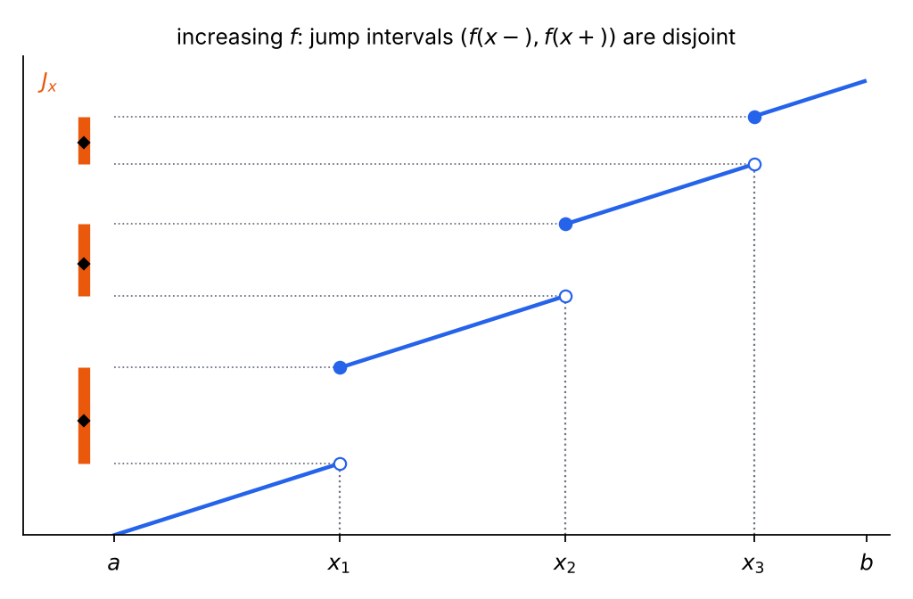
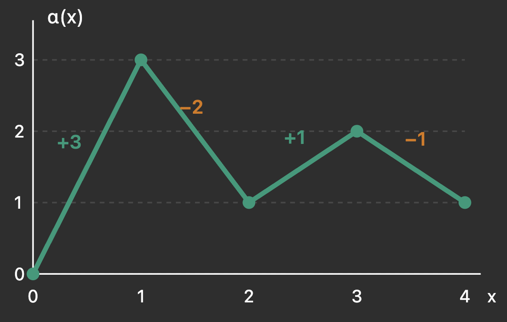
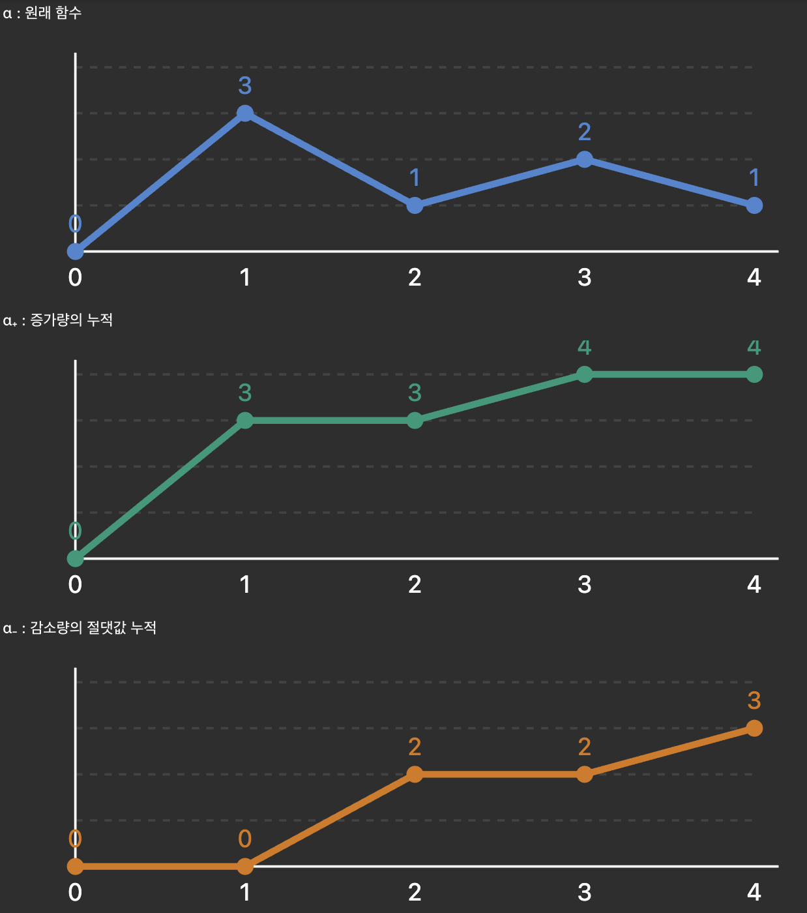

## $dx$ 대신 $d\alpha$로 적분하면 무엇을 얻는가?

4편에서 리만합 $\sum f(t_i)\,\Delta x_i$를 만든 재료는 두 가지였습니다. 각 조각에서의 함숫값과 조각의 길이 $\Delta x_i$입니다. 실해석으로 넘어가게 되면, 이 길이 자리에 측도를 넣게 됩니다. 이 글은 그 전 단계로, 길이를 가장 단순한 방식으로 바꾸는 방법인 리만-스틸체스(Riemann–Stieltjes) 적분을 알아보고자 합니다.

눈금이 고르지 않은 자를 생각해 봅시다. 증가함수 $\alpha$를 하나 정하고, 조각 $[x_{i-1}, x_i]$의 크기를 길이 대신 $\Delta\alpha_i = \alpha(x_i) - \alpha(x_{i-1})$로 잽니다.

- $\alpha(x) = x$이면 보통의 길이입니다.
- $\alpha(x) = x^2$이면 $[0, 1/2]$의 크기는 $1/4$, $[1/2, 1]$의 크기는 $3/4$입니다. 같은 길이라도 오른쪽이 더 무겁습니다.
- $\alpha$가 한 점 $s$에서 $c$만큼 뛰면, $s$를 포함하는 조각은 아무리 짧아도 크기가 $c$ 이상입니다. 점 하나가 양의 크기를 갖는 셈이고, 길이로는 일어날 수 없는 일입니다.

이 크기로 만든 합 $\sum f(t_i)\,\Delta\alpha_i$의 극한이 리만-스틸체스 적분 $\int f\,d\alpha$입니다. 그러면 어떤 $\alpha$까지 자로 쓸 수 있을지를 해석학에서는 중요하게 생각합니다. 크기가 음수가 아니려면 $\alpha$가 증가함수여야 하므로, 먼저 증가함수가 어떻게 생겼는지, 특히 점프가 얼마나 많을 수 있는지 봅니다. 그다음 크기가 음수일 수도 있는 $\alpha$를 어디까지 허용할지 정하고, 적분을 정의하고, 예제를 살펴보며 글을 마무리짓고자 합니다.

## 단조함수의 불연속점은 가산이다

보조정리 1 (단조함수의 한쪽 극한)

$f$가 $[a, b]$에서 증가함수이면 왼쪽 극한과 오른쪽 극한이 존재하고 다음이 성립합니다.

$$f(x-) = \sup\{f(t) : a \le t < x\} \;\le\; f(x) \;\le\; \inf\{f(t) : x < t \le b\} = f(x+)$$

**증명.** 왼쪽만 보입니다. $S = \{f(t) : a \le t < x\}$는 $f(x)$를 상계로 가지므로 2편의 상한공리에 의해 $s = \sup S \le f(x)$가 존재합니다. $\varepsilon > 0$이면 $f(t_0) > s - \varepsilon$인 $t_0 < x$가 있고, $t_0 < t < x$인 모든 $t$에서 $s - \varepsilon < f(t_0) \le f(t) \le s$입니다. 4편 4절의 정의에 의해 $f(x-) = s$입니다. $\blacksquare$

따라서 증가함수는 $f(x-) < f(x+)$인 점에서만 불연속이고, 이때 점프 구간 $J_x = (f(x-), f(x+))$는 공집합이 아닌 열린구간입니다.

정리 2 (단조함수의 불연속점)

$[a, b]$ 위의 증가함수의 불연속점 집합 $D$는 가산입니다.

**증명.** 끝점 두 개는 가산성에 영향이 없으므로 $D_0 = D \cap (a, b)$만 봅니다.

1. **점프 구간은 서로소다.** $x < y$인 $x, y \in D_0$에 대해 $x < t < y$인 $t$를 고르면 보조정리 1에 의해 $f(x+) \le f(t) \le f(y-)$이므로 $J_x \cap J_y = \emptyset$입니다.
2. **유리수를 대응시킨다.** $\mathbb{Q}$의 나열 $q_1, q_2, \dots$을 고정합니다(1편). $J_x$는 열린구간이므로 조밀성에 의해 유리수를 포함하고, 그중 번호가 가장 작은 것의 번호를 $n(x)$라 둡니다. 고르는 규칙을 하나로 정했으므로 선택공리가 필요 없습니다.
3. **단사다.** $n(x) = n(y)$이면 $q_{n(x)} \in J_x \cap J_y$이므로 $x = y$입니다. 따라서 $D_0$는 가산입니다. $\blacksquare$

**놓치기 쉬운 지점.** 증명의 핵심은 보조정리 1입니다. 한쪽 극한이 존재해야 불연속이 "점프"가 되고, 점프 구간이 열린구간이어야 유리수를 담습니다. 단조성이 없으면 이 구조가 무너집니다. 디리클레 함수는 모든 점에서 불연속이고, 어디서도 한쪽 극한이 없습니다.

## 유계변동(BV) = 단조증가 − 단조증가

$\alpha$가 증가함수가 아니면 크기 $\Delta\alpha_i$가 음수일 수 있습니다. $\lvert f \rvert \le M$이면 $\left\lvert \sum f(t_i)\,\Delta\alpha_i \right\rvert \le M \sum \lvert \Delta\alpha_i \rvert$이므로, $\sum \lvert \Delta\alpha_i \rvert$가 분할과 무관하게 유계이면 합이 통제됩니다.

참고 (삼각부등식)

삼각부등식 $\lvert a+b \rvert \le \lvert a \rvert + \lvert b \rvert$를 유한합으로 확장하면 다음과 같습니다.

$$\left\lvert\sum_{i=1}^n a_i\right\rvert \le \sum_{i=1}^n \lvert a_i \rvert$$

모든 $x\in[a,b]$에 대해 $\lvert f(x) \rvert \le M$이라고 가정했으므로, 각 표본점 $t_i$에서도 $\lvert f(t_i) \rvert \le M$이 성립합니다. 따라서

$$
\begin{aligned}
\left\lvert\sum_{i=1}^n f(t_i)\,\Delta\alpha_i\right\rvert
&\le \sum_{i=1}^n \lvert f(t_i)\rvert\,\lvert\Delta\alpha_i\rvert \\
&\le \sum_{i=1}^n M\,\lvert\Delta\alpha_i\rvert = M\sum_{i=1}^n\lvert\Delta\alpha_i\rvert
\end{aligned}
$$

정의 1 (전변동과 유계변동; Total Variation, Bounded Variation)

$V(\alpha, P) = \sum_{i} \lvert \alpha(x_i) - \alpha(x_{i-1}) \rvert$로 두고 $V_a^b(\alpha) = \sup_P V(\alpha, P)$를 전변동이라 합니다. 이 값이 유한하면 $\alpha$는 유계변동(BV)입니다.

전변동은 함수의 최종 변화량이 아니라, 함수가 움직인 전체변화량에 해당합니다. 증가함수라면 직관적으로 순변화량과 전변동이 동일하지만, 함수가 오르내리기 시작하면 두 값이 동일하지 않게 됩니다.

증가함수는 어떤 분할에서도 합이 망원식이 되어 $V_a^b(\alpha) = \alpha(b) - \alpha(a)$입니다. $\lvert \alpha^{\prime} \rvert \le M$이면 평균값정리로 $\lvert \Delta\alpha_i \rvert \le M\,\Delta x_i$이므로 $V_a^b(\alpha) \le M(b - a)$입니다. 삼각부등식에 의해 분할에 점을 추가하면 $V(\alpha, P)$는 줄지 않습니다.

보조정리 3 (구간 가법성)

$a < c < b$이면 $V_a^b(\alpha) = V_a^c(\alpha) + V_c^b(\alpha)$입니다.

**증명.** $[a, c]$와 $[c, b]$의 분할을 이어 붙이면 $[a, b]$의 분할이므로 오른쪽 $\le$ 왼쪽입니다. 반대로 $[a, b]$의 분할에 $c$를 추가하면 변동이 줄지 않고 두 부분으로 나뉘므로 왼쪽 $\le$ 오른쪽입니다. $\blacksquare$

정리 4 (Jordan 분해)

$\alpha$가 BV인 것은 두 증가함수 $g, h$로 $\alpha = g - h$라 쓸 수 있는 것과 동치입니다.

**증명.**

- ($\Leftarrow$) $V(\alpha, P) \le (g(b) - g(a)) + (h(b) - h(a))$입니다.
- ($\Rightarrow$) 전변동함수 $V(x) = V_a^x(\alpha)$를 둡니다. $a \le x < y \le b$이면 보조정리 3과 분할 $\{x, y\}$에 의해 다음이 성립합니다.

$$V(y) - V(x) = V_x^y(\alpha) \ge \lvert \alpha(y) - \alpha(x) \rvert$$

절댓값을 양쪽으로 풀면 $V(y) - V(x) \ge 0$이고 $V(y) - V(x) \ge \alpha(y) - \alpha(x)$이므로, $V$와 $V - \alpha$가 모두 증가함수입니다. $\alpha = V - (V - \alpha)$입니다. $\blacksquare$

**예.** 위의 꺾은선 $\alpha$를 증가량의 누적 $\alpha_{+}$와 감소량 절댓값의 누적 $\alpha_{-}$로 나누면 다음과 같습니다.

$$
\begin{gathered}
\alpha = \alpha_{+} - \alpha_{-} \\
V_0^4(\alpha) = 4 + 3 = 7
\end{gathered}
$$

## 리만-스틸체스 적분

정의 2 (리만-스틸체스 적분, $\alpha$가 증가함수)

$\Delta\alpha_i = \alpha(x_i) - \alpha(x_{i-1}) \ge 0$으로 두고 $U(f, P, \alpha) = \sum M_i\,\Delta\alpha_i$, $L(f, P, \alpha) = \sum m_i\,\Delta\alpha_i$를 정의합니다. $\inf_P U = \sup_P L$이면 그 값을 $\int_a^b f\,d\alpha$로 씁니다. $\alpha(x) = x$이면 리만적분입니다.

4편의 보조정리 1과 리만 판정법은 $\Delta x_i$를 $\Delta\alpha_i$로 바꿔도 증명방식이 동일합니다. 예를 통해 살펴보겠습니다.

**예.** $\int_0^1 x\,d(x^2)$. $\alpha(x) = x^2$을 자로 쓰고 $f(x) = x$를 적분합니다. $n$등분 분할에서 $\Delta\alpha_i = (i/n)^2 - ((i-1)/n)^2 = (2i - 1)/n^2$이고, $f$가 증가하므로 $M_i = i/n$, $m_i = (i-1)/n$입니다. 제곱수의 합 공식을 쓰면 다음과 같습니다.

$$U(f, P_n, \alpha) = \sum_{i=1}^{n} \frac{i}{n}\cdot\frac{2i-1}{n^2} = \frac{(n+1)(4n-1)}{6n^2}, \qquad L(f, P_n, \alpha) = \sum_{i=1}^{n} \frac{i-1}{n}\cdot\frac{2i-1}{n^2} = \frac{(n-1)(4n+1)}{6n^2}$$

$n \to \infty$이면 둘 다 $4/6 = 2/3$으로 가므로 $\int_0^1 x\,d(x^2) = 2/3$입니다. 두 값의 차이는 $U - L = 1/n$으로 4편의 $f(x) = x$와 똑같습니다. 우연이 아닙니다. 모든 조각에서 $M_i - m_i = 1/n$이므로 $U - L = \frac{1}{n}\sum \Delta\alpha_i = \frac{1}{n}(\alpha(1) - \alpha(0))$이고, 자가 바뀌어도 크기의 총합이 1이면 같은 값이 나옵니다. 답이 4편의 $1/2$보다 큰 것은 이 자가 오른쪽에 무게를 더 주기 때문입니다.

정리 5 ($f$ 연속, $\alpha$ 증가)

$f$가 $[a, b]$에서 연속이면 $\int_a^b f\,d\alpha$가 존재하고, 눈금이 0으로 갈 때 각 조각에서 **아무렇게나 고른 $t_i$**에 대해 $\sum f(t_i)\,\Delta\alpha_i \to \int_a^b f\,d\alpha$입니다.

**증명.** 4편 정리 2의 고른연속에서 $\lvert x - y \rvert < \delta \Rightarrow \lvert f(x) - f(y) \rvert < \varepsilon/(\alpha(b) - \alpha(a))$인 $\delta$를 잡습니다. 눈금이 $\delta$보다 작으면

$$U(f, P, \alpha) - L(f, P, \alpha) < \frac{\varepsilon}{\alpha(b) - \alpha(a)} \sum_{i} \Delta\alpha_i = \varepsilon$$

입니다. $\sum f(t_i)\,\Delta\alpha_i$와 적분값은 둘 다 $L$과 $U$ 사이에 있으므로 차이가 $\varepsilon$보다 작습니다. ($\alpha$가 상수이면 모든 합이 0입니다.)

![한 조각 [x_{i-1}, x_i]에서 f의 변동폭 M_i − m_i(위)와 그 조각의 크기 Δα_i(아래). 조각의 너비가 δ보다 작으면 M_i − m_i가 작아진다](/assets/img/posts/2026-11-27-riemann-stieltjes-upper-lower.png)

즉, 다음과 같습니다.

$$U-L \leq \underbrace{\max_i(M_i-m_i)}_{\text{고른연속으로 0에 수렴}} \cdot\underbrace{(\alpha(b)-\alpha(a))}_{\text{유한한 상수}} \qquad \blacksquare$$

정의 3 (리만-스틸체스 적분, $\alpha$가 BV)

정리 4로 $\alpha = g - h$라 쓰면 $\sum f(t_i)\,\Delta\alpha_i = \sum f(t_i)\,\Delta g_i - \sum f(t_i)\,\Delta h_i$이고, 정리 5에 의해 우변이 수렴합니다. 그 극한을 $\int_a^b f\,d\alpha$로 정의합니다. 왼쪽은 $\alpha$만으로 쓰여 있으므로 어떤 분해를 골랐는지와 무관합니다.

적분변수의 두 극단은 다음과 같습니다(증명 생략, Rudin 6장).

### 매끄러운(미분 가능한) $\alpha$는 보통의 적분

$\alpha^{\prime}$이 연속이면 $\int f\,d\alpha = \int f\,\alpha^{\prime}\,dx$입니다. 각 조각에서 평균값정리의 점을 $t_i$로 고르면 리만-스틸체스 합이 그대로 $f\alpha^{\prime}$의 리만합이 됩니다. 위의 예로 검산하면 $\int_0^1 x \cdot 2x\,dx = 2/3$입니다.

### 점프하는 $\alpha$는 합

$\alpha$가 $s$에서 0에서 $c$로 뛰는 계단함수이면 $\int f\,d\alpha = c\,f(s)$입니다. $\Delta\alpha_i \ne 0$인 조각은 $s$를 포함하는 하나뿐이고, 눈금이 0으로 가면 그 조각의 $t_i$가 $s$로 가기 때문입니다.

### 확률로 읽으면

분포함수 $F_X(x) = P(X \le x)$는 증가함수이고, $\Delta F_i = P(x_{i-1} < X \le x_i)$는 조각에 떨어질 확률입니다. 즉 $F_X$는 "확률로 재는 자"이고, $\sum g(t_i)\,\Delta F_i$는 조각마다 $g$의 값에 그 조각의 확률을 곱해 더한 것입니다.

### $E = (0,1]$에서 보기: 섞인 분포

확률 $1/2$로 0이고 확률 $1/2$로 $E$ 위의 균등분포인 $X$는 합 공식에도 밀도 공식에도 들어가지 않습니다. 0에 질량이 몰려 있어서 밀도가 없고, 나머지는 퍼져 있어서 합으로 쓸 수 없습니다. 분포함수는 $[-1, 1]$에서 $x < 0$이면 $F(x) = 0$, $0 \le x \le 1$이면 $F(x) = (1 + x)/2$입니다. $F$를 0에서 $1/2$만큼 뛰는 부분과 $[0, 1]$에서 기울기 $1/2$로 올라가는 부분으로 나누면 위의 두 극단이 각각 적용됩니다.

$$\int_{-1}^{1} g\,dF = \frac{1}{2}\,g(0) + \frac{1}{2}\int_0^1 g(x)\,dx$$

$g(x) = x$이면 $E[X] = 1/4$입니다. 앞항은 원자에서, 뒷항은 밀도에서 왔습니다. 일반적인 기댓값은 실해석에서 르벡적분으로 정의하고, 그때 $E[g(X)] = \int g\,dF_X$가 정리가 됩니다.

**놓치기 쉬운 지점.** 정리 5는 $f$의 연속성을 가정합니다. $[-1, 1]$에서 $f = \alpha$가 둘 다 $x < 0$이면 0, $x \ge 0$이면 1이라 합시다. 어떤 분할에서든 0을 포함하는 조각 $(x_{i-1} < 0 \le x_i)$에서만 $\Delta\alpha_i = 1$이고 그 조각에서 $M_i = 1$, $m_i = 0$이므로, 항상 $U = 1$, $L = 0$입니다. 크기가 몰린 점에서 $f$가 뛰면 적분이 존재하지 않을 수 있습니다.

### 치환적분과 리만-스틸체스 적분

$f$가 연속이고 $\alpha(x)$가 연속 미분 가능하다면

$$d\alpha(x) = \alpha^{\prime}(x)\,dx$$

이므로 리만-스틸체스 적분은

$$\int_a^b f(x)\,d\alpha(x) = \int_a^b f(x)\,\alpha^{\prime}(x)\,dx$$

입니다. 여기서 $\alpha$가 엄격한 단조함수(Strictly Monotone Function)이어서 역함수를 갖는다면, $u = \alpha(x)$로 치환하여

$$= \int_{\alpha(a)}^{\alpha(b)} f(\alpha^{-1}(u))\,du$$

가 되고, 이는 미적분학에서 사용하는 치환적분의 형태입니다.

## 유계변동의 경계: 확률미적분으로

피적분함수가 연속이고 적분자가 유계변동이면 리만-스틸체스 적분의 존재가 보장됩니다. 그렇다면 연속이지만 유계변동이 아닌 함수를 적분자로 사용하면 어떻게 될까요?

대표적인 예가 브라운 운동(Brownian motion)입니다. 브라운 운동의 표본경로는 거의 확실하게 연속이지만, 양의 길이를 갖는 모든 구간에서 전변동이 무한합니다. 따라서 앞에서 증명한 적분의 존재 정리를 적용할 수 없습니다.

더욱이 브라운 운동을 적분자로 사용하면 분할의 눈금을 아무리 작게 하더라도 표본점의 선택에 따른 적분합의 차이가 사라지지 않는 경우가 발생합니다. 이 문제를 해결하기 위해서는 새로운 적분 개념과 수렴 방식이 필요하며, 이것이 Itô 적분을 비롯한 확률적분 이론의 출발점입니다.

길이를 함수의 변화량으로 바꾸는 것에서 시작한 이 글은, 결국 어떤 대상을 적분의 가중치로 사용할 수 있는가라는 질문으로 돌아옵니다. 실해석에서는 이 질문을 측도라는 개념으로 더욱 일반화하게 됩니다.
